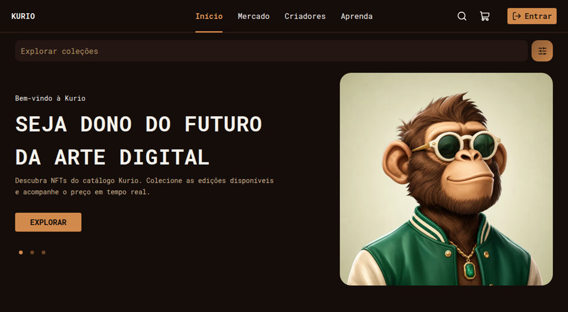

  
  <h1>Luiz Henrique da Veiga Dalagnol</h1>
  

    <strong>Front-end Developer</strong> 
    React · TypeScript · React Native
  

  

    Desenvolvo interfaces web e mobile para produtos em produção. 
    Atuo em projetos corporativos e na evolução de um produto SaaS. 
    O foco é componentização, integração com APIs e consistência de interface.
  

  

    
    
    
    
  

  
Brasil · Aberto a oportunidades remotas

## Sobre

Atuo como desenvolvedor Front-end na Squadra Digital, em projetos corporativos para Honda e MRV&CO. Na Honda, mantenho e evoluo páginas e componentes com Vue.js e Drupal. Na MRV&CO, desenvolvo aplicações em React e React Native, com interfaces de gestão operacional e integração a APIs REST.

Também sou cofundador da [Amparo Sistemas](https://use-amparo.com/). Participo da evolução de uma plataforma SaaS voltada à gestão e operação de clínicas.

## Stack

A ordem destaca o foco do trabalho. Os badges não representam nível de proficiência.

### Front-end e Mobile

 

### Estilização e UI

### Testes e Qualidade

### Ferramentas e Integrações

## Experiência

### Squadra Digital · Desenvolvedor Front-end

**Honda** · Vue.js e Drupal

Manutenção e evolução de aplicações e páginas web. Desenvolvimento e atualização de componentes em Vue.js. Gerenciamento de conteúdos e componentes em Drupal.

**MRV&CO** · React, React Native e APIs REST

Desenvolvimento de aplicações web e mobile. Interfaces para gestão operacional, integração com APIs REST, componentização e evolução de funcionalidades.

### Amparo Sistemas · Cofundador

Participação no desenvolvimento e na evolução de uma plataforma SaaS de gestão e operação de clínicas.

[use-amparo.com](https://use-amparo.com/)

## Projetos em destaque

### KURIO

Marketplace de NFTs do desafio de front-end da Jungle. A aplicação, em React e TypeScript, reúne catálogo, detalhe do item, autenticação, carrinho e compra. Dados, sessão e atualizações em tempo real são simulados no navegador. O repositório inclui testes unitários com Vitest e testes end-to-end com Playwright.

React · TypeScript · Tailwind CSS · TanStack Query · TanStack Router · Vitest · Playwright

[Código](https://github.com/LuizHvD/jungle-nft-marketplace) · [Demonstração](https://jungle-nft-marketplace-two.vercel.app)

## Atividade

Contribuições deste perfil público. O trabalho corporativo permanece em repositórios privados e não entra nesta grade.

<picture>
  <source media="(prefers-color-scheme: dark)" srcset="./dist/github-contribution-grid-snake-dark.svg">
  
</picture>

## Contato

  
Para conversas sobre posições de Front-end e produtos digitais:

  

    
    
    
    
  

