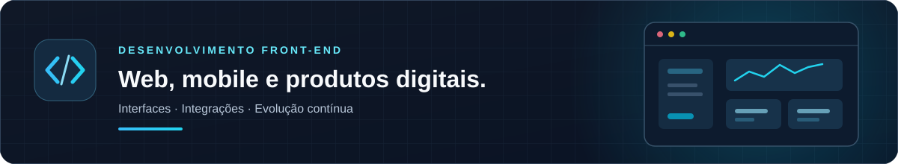

  
  <h1>Luiz Henrique da Veiga Dalagnol</h1>
  
<strong>Desenvolvedor Front-end · React · TypeScript · React Native</strong>

  

    Desenvolvo e evoluo aplicações web e mobile para produtos em produção. 
    Experiência em soluções corporativas e SaaS, com foco em interfaces, integrações e usabilidade.
  

  
Rio Grande do Sul, Brasil · Aberto a oportunidades remotas

  

    
    
  

## Sobre

Sou desenvolvedor Front-end na **Squadra Digital** e cofundador da [Amparo Sistemas](https://use-amparo.com/). Minha atuação combina desenvolvimento de interfaces, integração com APIs REST e evolução de produtos digitais, tanto em projetos corporativos quanto em uma plataforma SaaS.

## Experiência

### Squadra Digital · Desenvolvedor Front-end

**Honda** · Vue.js e Drupal · Atuação atual

- Manutenção e evolução de páginas, componentes e conteúdos no ecossistema web da Honda.
- Atualização de imagens, links e dados de produtos, com validação visual das alterações nos ambientes de desenvolvimento e homologação.

**MRV&CO** · React, React Native e TypeScript · Experiência anterior

- Desenvolvimento de interfaces web para relatórios operacionais, incluindo filtros e consultas integradas a APIs REST.
- Evolução de funcionalidades mobile voltadas à gestão de equipes e ao apontamento de presença, com atenção à experiência em dispositivos Android.

### Amparo Sistemas · Cofundador

- Participação no desenvolvimento e na evolução de uma plataforma SaaS para clínicas, com recursos de agenda, acompanhamento de atendimentos e gestão de arquivos.
- Atuação nas decisões de produto e na melhoria contínua dos fluxos da plataforma.

[Conhecer a Amparo Sistemas](https://use-amparo.com/)

## Stack

### Front-end e Mobile

### Estilização e UI

### Testes e Qualidade

### Ferramentas e Integrações

## Atividade no GitHub

<picture>
  <source media="(prefers-color-scheme: dark)" srcset="./dist/github-contribution-grid-snake-dark.svg">
  
</picture>
